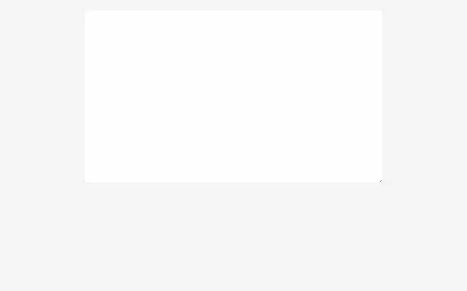
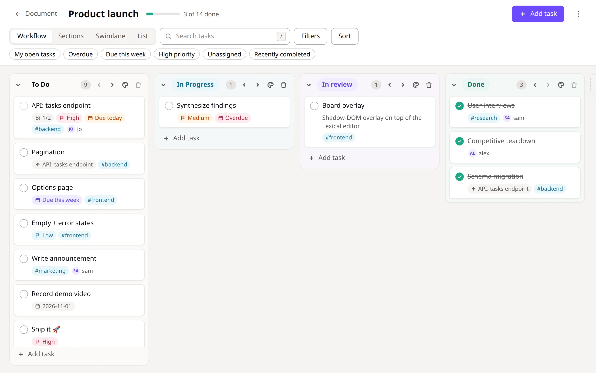
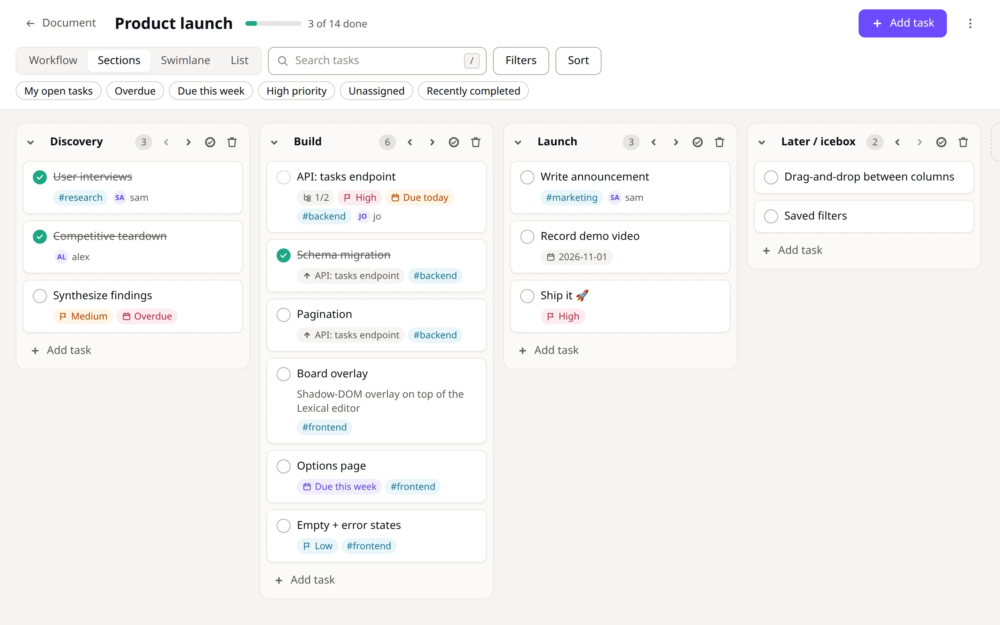
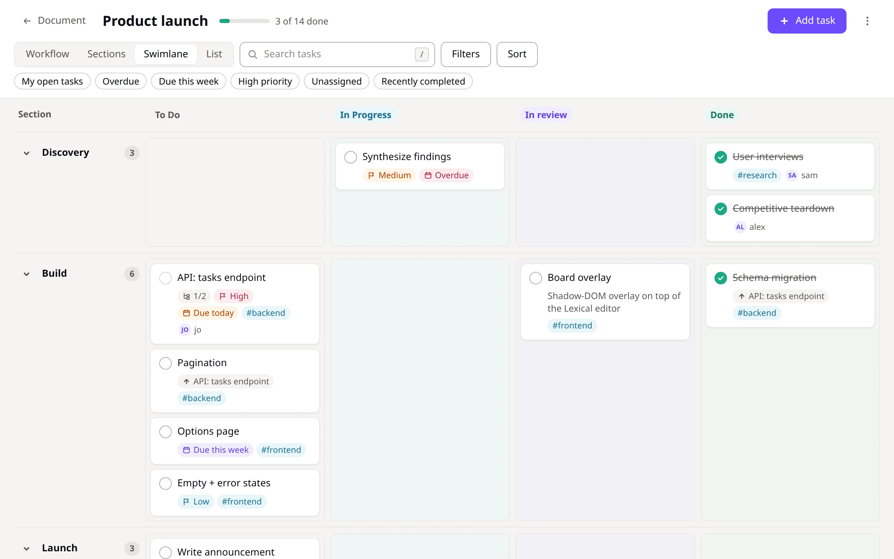
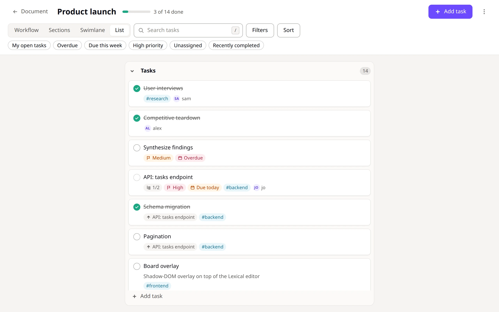
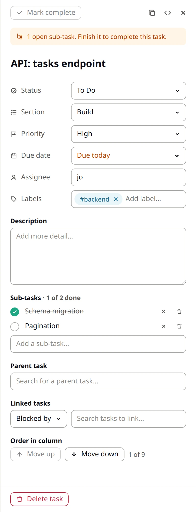
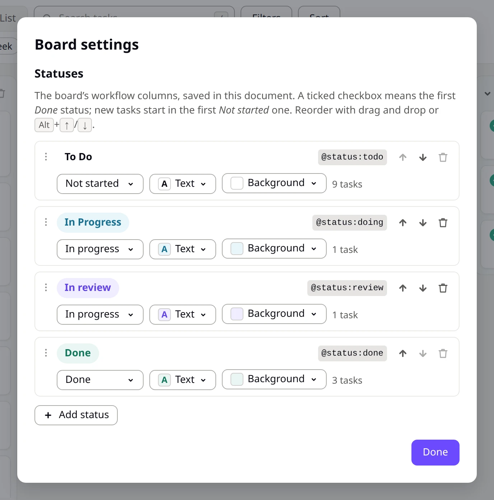
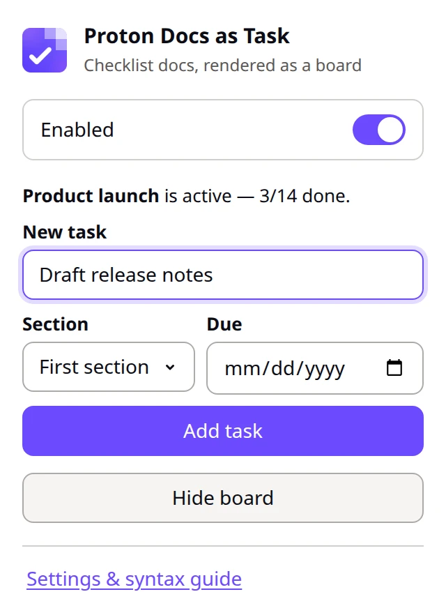

<p align="center">
  
</p>

<h1 align="center">Proton Docs as Task</h1>

<p align="center">
  Turn a <a href="https://proton.me/drive/docs">Proton Docs</a> document into a task board.<br />
  Your tasks stay a plain checklist in the document, so they sync and share like any other doc.
</p>

<p align="center">
  <a href="https://github.com/josselinonduty/proton-docs-as-task/releases/latest"></a>
  <a href="https://github.com/josselinonduty/proton-docs-as-task/actions/workflows/ci.yml"></a>
  <a href="LICENSE"></a>
</p>

<p align="center">
  
</p>

- **The document is the source of truth.** The board reads the checklist and
  writes every change back through Proton's own editor, so collaborators,
  history and your other devices see ordinary text.
- **Private by design.** Everything runs in your browser. No account, no
  server, no network requests; the only permission is storage for your settings.
- **Feels like Proton.** Proton's look, light and dark themes, full keyboard
  support, and nine languages.

## Screenshots

<picture>
  <source media="(prefers-color-scheme: dark)" srcset="assets/readme/workflow-dark.webp" />
  
</picture>

| Sections                                                                                  | Swimlane                                                                                 |
| ----------------------------------------------------------------------------------------- | ---------------------------------------------------------------------------------------- |
|     |  |
| **List**                                                                                  | **Sub-tasks**                                                                            |
|                   |       |
| **Board settings**                                                                        | **Popup quick add**                                                                      |
|  |               |

## Install

Download the latest package from
[Releases](https://github.com/josselinonduty/proton-docs-as-task/releases/latest).

**Chrome, Edge and other Chromium browsers**

1. Download `proton-docs-as-task-<version>-chrome.zip` and unzip it.
2. Open `chrome://extensions` and turn on **Developer mode**.
3. Click **Load unpacked** and select the unzipped folder.

**Firefox**

1. Download `proton-docs-as-task-<version>-firefox.zip`.
2. Open `about:debugging` → **This Firefox** → **Load Temporary Add-on**, and
   pick the zip.

> [!IMPORTANT]
> Firefox removes an add-on loaded this way when it restarts. Load it again
> after each restart until the add-on is signed on addons.mozilla.org.

## Quick start

1. **Pick your setup.** A welcome page opens after installing: choose a layout
   (simple list, Kanban or swimlanes), the statuses for new boards, and a few
   preferences. Skipping is fine; everything stays editable in the options.
2. **Make a board.** Open an empty document on `docs.proton.me` and click
   **Create task board**. A document whose first line is `#!tasks` becomes a
   board too.

## Features

- **Four views** of the same tasks: Workflow (by status), Sections (by
  heading), Swimlane (both) and List. Switching never changes the document.
- **Your own statuses per board**, with categories and colours, managed from
  Board settings. New boards start from the flow you picked.
- **Sub-tasks** at any depth; a parent can't be completed while a sub-task is
  open.
- **Task links**: _blocked by_ and _related to_.
- **Fast capture** from the board header, any column, or the toolbar popup
  without opening the board.
- **Sorting, filters and presets** (_My open tasks_, _Overdue_, _Due this
  week_ and more), all non-destructive.
- **Bulk edit** a selection in one undoable step.
- **Keyboard first**: shortcuts for everything, a command palette
  (`Ctrl`/`Cmd`+`K`) and undo.
- **Live and collaborative**: changes from collaborators or other devices
  appear immediately and merge with yours.
- **Nine languages**: English, French, German, Spanish, Italian, Japanese,
  Portuguese, Dutch and Chinese.

How each feature works is in the [user guide](docs/GUIDE.md).

## Task syntax

The board writes this for you, but you can also type it. A document becomes a
board when its first non-empty line starts with an activation marker (`#!tasks`
by default), optionally followed by the board's title.

```text
#!tasks Sprint 42

## Backend
- [x] Design the schema @who:sam
- [ ] Build the API @status:doing @priority:high @due:2026-09-10 #api

## Frontend
- [ ] Wire up the board @@jo !!
- [ ] Polish styles #ui
```

| Token                                  | Meaning                                                                      |
| -------------------------------------- | ---------------------------------------------------------------------------- |
| `- [ ]` / `- [x]`                      | An open / done task                                                          |
| `## Heading`                           | A section                                                                    |
| `@status:doing`                        | The task's status, by key ([statuses](docs/GUIDE.md#statuses))               |
| `@priority:high`                       | `high`, `medium` or `low`; also `!!!`, `!!` or `!`                           |
| `@due:2026-09-10`                      | Due date                                                                     |
| `@who:alex` / `@@alex`                 | Assignee                                                                     |
| `#label`                               | One or more labels                                                           |
| `@parent:key`                          | Sub-task of the task marked `@id:key` ([sub-tasks](docs/GUIDE.md#sub-tasks)) |
| `@id:key` `@blocks:key,key` `@rel:key` | Task links, managed from the task panel                                      |
| `@desc(free text)`                     | A one-line description, managed from the board                               |
| `@settings status …`                   | A status definition, right below the marker, managed from Board settings     |

A ticked checkbox always means a _Done_ status. Otherwise `@status` applies,
and a task without one gets the first _Not started_ status. See
[`examples/sample-board.md`](examples/sample-board.md) for a fuller board.

<details>
<summary><strong>Keyboard shortcuts</strong></summary>

| Key                    | Action                          |
| ---------------------- | ------------------------------- |
| `N`                    | Add a task                      |
| `/`                    | Search                          |
| `F`                    | Filters                         |
| `V`                    | Change view                     |
| `S`                    | Sort                            |
| `J` / `K`              | Next / previous card            |
| `Enter`                | Open the focused card           |
| `E`                    | Rename the focused card         |
| `Space`                | Select the focused card         |
| `X`                    | Toggle completion               |
| `M`                    | Move the focused card           |
| `Delete` / `Backspace` | Delete the selection            |
| `Cmd`/`Ctrl`+`Z`       | Undo                            |
| `Cmd`/`Ctrl`+`K`       | Command palette                 |
| `Esc`                  | Close the active menu or dialog |
| `?`                    | All shortcuts                   |

</details>

## Learn more

- [User guide](docs/GUIDE.md): views, capture, filters, sub-tasks, statuses and settings
- [How it works](docs/ARCHITECTURE.md): the editor bridge, project layout and limitations
- [Contributing](CONTRIBUTING.md): development setup, playground and checks
- [Releasing](docs/RELEASING.md): release-please and store submission
- [Privacy](PRIVACY.md) and [security](SECURITY.md)

## License

[MIT](LICENSE) © josselinonduty

This project is an independent, unofficial tool and is not affiliated with or
endorsed by Proton AG. "Proton" and "Proton Docs" are trademarks of Proton AG.
